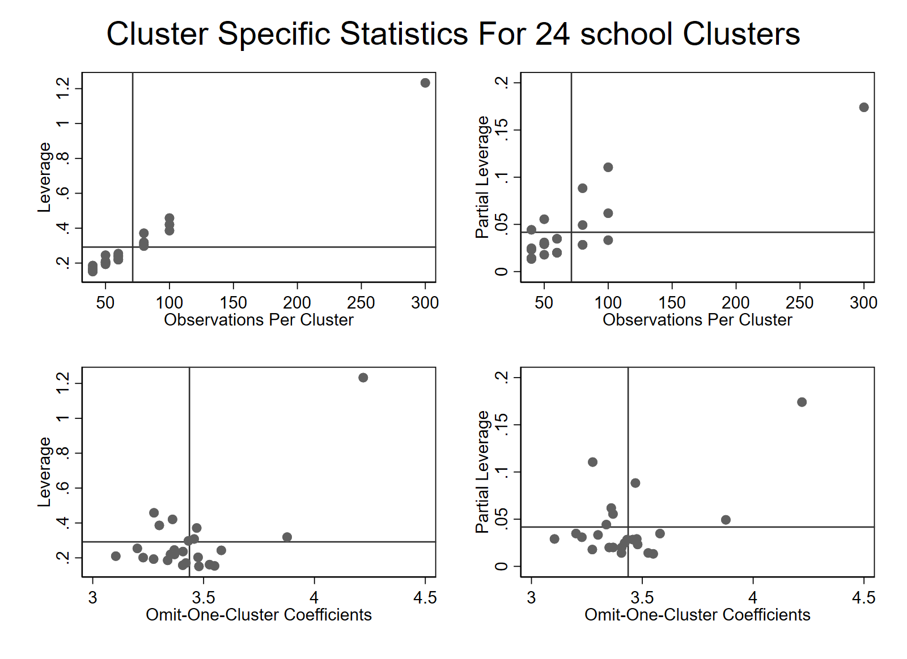

# Using summclust in Stata

`summclust` helps you see whether a small number of clusters drive a regression
coefficient and its uncertainty. It estimates the regression you specify and
reports cluster sizes, leverage, and what happens to the coefficient when
each cluster is left out.

[Back to the overview](../README.md) · [R guide](../R/README.md) ·
[Python guide](../python/README.md)

## Get started

You need Stata 13 or later. No other Stata packages are required.

Download this repository using **Code → Download ZIP** and extract it. Set
Stata's working directory to the extracted folder containing the top-level
README. To use this copy for your current session:

```stata
adopath ++ "Stata"
discard
```

To install it for future sessions, use the full path to the `Stata` folder
on your computer, for example:

```stata
net install summclust, from("C:/path/to/summclust/Stata") replace
discard
help summclust
```

Replace the example path with your own. `which summclust` shows which copy
Stata is using if you already had an older installation.

## Example: a school program

The [teaching dataset](../examples/README.md) contains 1,710 fictional student
observations in 24 schools from 2019 to 2023. We estimate the difference in
test scores associated with program availability, controlling for baseline
scores and year fixed effects. Standard errors are clustered by school.

```stata
import delimited using "examples/school_program.csv", clear
summclust test_score program baseline_score, cluster(school) fevar(year) table
```

The order matters: `test_score` is the outcome, `program` is the variable of
interest, and `baseline_score` is a control. At least one control is required.
`summclust` fits the model directly; you do not need to run `regress` first.
`school` contains string labels such as `School 01`, which work directly.

`fevar(year)` includes year indicators. `table` requests school-by-school
diagnostics. With one-way clustering, a four-panel plot is drawn by default;
add `nograph` to suppress it.

Actual regression output:

```text
There are 1710 observations within 24 school clusters.

Regression Output

  s.e. |      Coeff   Sd. Err.   t-stat  P value    CI-lower    CI-upper
-------+----------------------------------------------------------------
   CV1 |   3.426371   0.870672   3.9353   0.0007    1.625250    5.227492
   CV3 |   3.426371   1.059436   3.2341   0.0037    1.234761    5.617981
------------------------------------------------------------------------
```

The adjusted program difference is **3.43 score points**. CV1 and CV3 are
different standard-error calculations for that same coefficient. CV1 is
the conventional cluster-robust calculation; CV3 uses the estimates obtained
by leaving out each school in turn. Here its standard error is larger:
1.06 rather than 0.87. Its 95% confidence interval is **1.23 to 5.62 points**.
This fictional example illustrates the output, not a causal finding about
a real program.

## Which schools matter?

The school-level table contains four diagnostics:

| Column | How to read it |
|---|---|
| `Ng` | Number of observations in the school. |
| `Leverage` | The school's contribution to the regression design as a whole, reflecting its size and combination of regressor values. Larger values indicate greater potential influence. This is not a percentage. |
| `Partial L.` | Its share of the variation in `program` remaining after accounting for the other regressors. Shares sum to one. |
| `beta no g` | The program coefficient after leaving this school out. Compare it with the full-sample estimate of 3.43. |

Three rows from the actual table:

```text
    school |       Ng      Leverage     Partial L.  beta no g
-----------+-----------------------------------------------------
 School 01 |       40      0.153976       0.013278   3.549357
 School 13 |      100      0.458228       0.110505   3.276289
 School 24 |      300      1.233361       0.174064   4.220215
```

School 24 supplies about **17.4%** of the remaining program variation,
compared with **4.2%** if all 24 schools contributed equally. Leaving it out
raises the estimated difference to **4.22 points**. School 13 also has a
relatively large partial leverage, but leaving it out changes the estimate
less. Potential influence and actual sensitivity are different questions.

The equal-share comparison is a useful reference, not a cutoff for deciding
which schools to remove. Investigate influential clusters and explain any
sensitivity in your results.

The `Cluster Variability` table summarizes each diagnostic across schools.
Its `coefvar` row measures relative dispersion: larger values mean greater
unevenness. It is not a test statistic or an automatic decision rule.

## See the pattern in a plot

This is the plot produced by the example command:



Each point is a school. The rightmost point in the upper panels is the
300-observation school. In the lower panels, the horizontal position is the
estimate after excluding that school. Reference lines mark the means of the
plotted quantities, not statistical significance thresholds.

The complete [example do-file](../examples/school_program.do) runs the model
and saves the plot under `output/`:

```stata
do examples/school_program.do
```

## Adapt the model to your data

Put the coefficient you want to investigate immediately after the outcome:

```stata
summclust outcome treatment control1 control2, cluster(village) table nograph
```

The rest of this section uses the school dataset. To restrict the sample,
use `sample()` rather than Stata's usual `if` qualifier:

```stata
summclust test_score program baseline_score, cluster(school) fevar(year) sample(year>=2021) nograph
```

To include school as well as year fixed effects with one-way school clustering,
absorb the school effects:

```stata
summclust test_score program baseline_score, cluster(school) absorb(school) fevar(year) nograph
```

That changes the model: the program coefficient now uses changes within
schools after allowing for year effects. The example has program changes
within schools. A treatment that never changes within a school cannot be
estimated separately from school fixed effects.

Both `fevar()` and `absorb()` accept numeric or string identifiers.
`absorb()` removes one fixed effect by subtracting group means, and requires
each absorbed group to lie within a cluster. With two-way clustering, it
must lie within a cluster in both dimensions. Use `fevar()` for crossed
effects, such as school effects when clustering by school and year.
Observations with missing model variables or empty string identifiers are
excluded. Factor notation such as `i.year` and weights are not accepted in
the main variable list.

## Two-way clustering and the mixed option

When your research design calls for clustering in two dimensions, put both
identifiers in `cluster()`:

```stata
summclust test_score program baseline_score, cluster(school year) fevar(year) nograph
summclust test_score program baseline_score, cluster(school year) fevar(year) mixed nograph
```

The example has only five years, so the year dimension is small and the
reported tests have just four degrees of freedom. These commands illustrate
syntax, not a recommendation to rely on two-way inference with so few years.

The ordinary two-way output labels its rows `CV1max` and `CV3max`. Each uses
the largest of the conventional two-way standard error and the two
corresponding one-way standard errors. A note identifies which component
supplies the maximum. The conventional two-way result is also shown.

`mixed` replaces the CV3 row with `CV31max`. It combines the two one-way CV3
components with a CV1 adjustment for their intersections. This can save
computation, but it is a different calculation and is used only when you ask
for it. It does not replace CV3 automatically. Two-way models do not draw the
four-panel plot.

## More detail

Run `help summclust` for all options and saved results, including `regtable`,
effective-cluster measures, and rank diagnostics. `return list` shows the
results from your most recent call. For one-way models, the numeric diagnostic vectors
`r(ng)`, `r(lever)`, `r(partlev)`, and `r(betanog)` are available for your own
tables; their rows follow sorted cluster identifiers in the estimation sample.
Two-way results have suffixes for each clustering dimension and their
intersections; see `help summclust` for the names.

For the statistical background and citation, see
[MacKinnon, Nielsen, and Webb](https://arxiv.org/abs/2205.03288).
